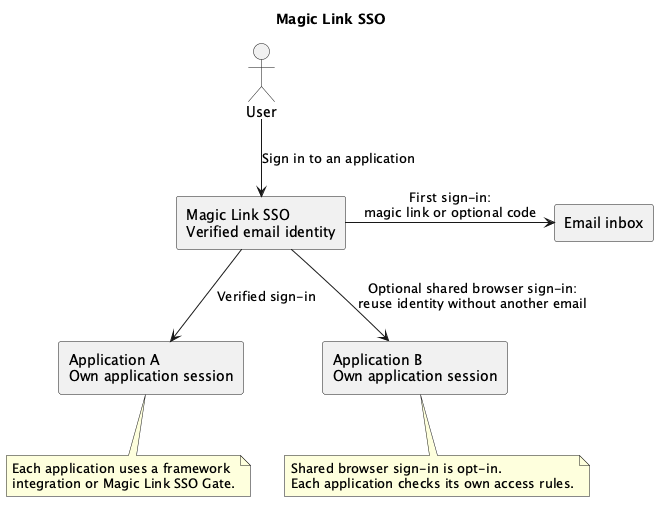
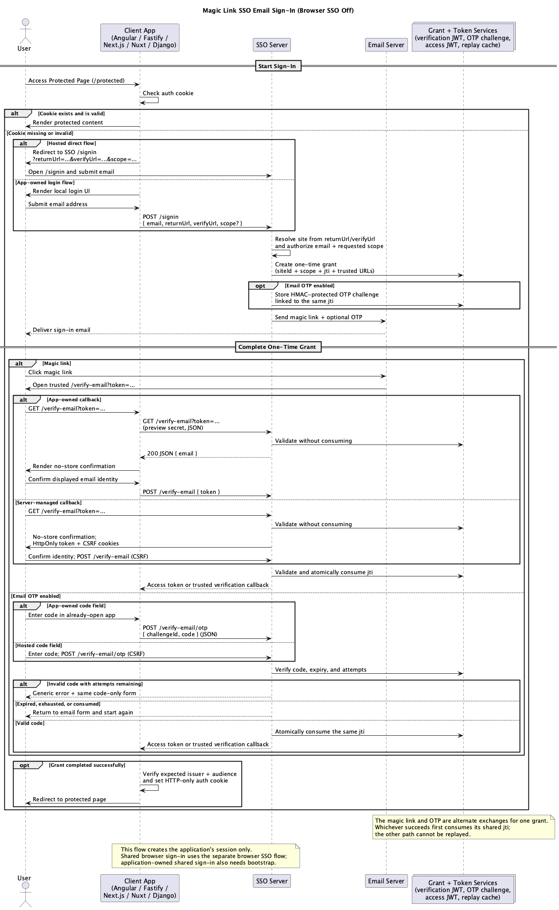

# Magic Link SSO

Passwordless sign-in for self-hosted apps.

Magic Link SSO is a self-hosted email-based SSO server for small private
deployments. It sends time-limited magic links, optionally includes a short
email OTP for mobile and PWA sign-in, issues JWT session tokens, and can run
without a database.

Get started by
[protecting an existing app with Gate](./docs/first-deployment.md#protect-an-existing-app-with-gate)
or
[building an app with an SDK](./docs/first-deployment.md#build-an-app-with-an-sdk).

This repository contains the server, reusable framework packages, the Magic Link
SSO Gate reverse-proxy service, and example apps for Angular, Django, Fastify,
Next.js, Nuxt, and the managed-mode Photos demo, plus two Gate-backed private
resources: `private1` as a dynamic upstream example and `private2` as a static
site example. See [Magic Link SSO Gate](#magic-link-sso-gate).

Magic Link SSO also supports two operator workflows:

- classic mode: the server reads one operator-maintained TOML file
- managed mode: an optional manager generates a runtime TOML from static config
  plus manager-owned access state

For agent-agnostic setup and integration skills that can be installed into tools
such as Codex, Claude, and Gemini, see the separate
[magic-link-sso/skills](https://github.com/magic-link-sso/skills) repository.

## At a glance

<picture>
  <source media="(prefers-color-scheme: dark)" srcset="./docs/MagicLinkSSO_Overview_dark.png">
  <source media="(prefers-color-scheme: light)" srcset="./docs/MagicLinkSSO_Overview_light.png">
  
</picture>

Magic Link SSO can protect private resources two ways:

- framework integration, where the app owns the callback and session handling
- Gate reverse proxy, where Gate owns the callback and fronts a private upstream

Either way the server checks an emailed grant instead of a password or HTTP
Basic Auth. Every email carries a magic link. With optional OTP enabled it also
carries a short code you can type into the app or hosted page that started
sign-in.

If you are deciding between Magic Link SSO, Better Auth, Keycloak, or a broader
identity platform, see
[Choosing an auth option](./docs/auth-options-comparison.md).

## Contents

- [How it works](#how-it-works)
- [Getting started](#getting-started)
- [First deployment guide](./docs/first-deployment.md)
- [Deployment modes](#deployment-modes)
- [Configuration reference](#configuration-reference)
- [Operator diagnostics](./docs/doctor.md)
- [Framework integrations](#framework-integrations)
- [Magic Link SSO Gate](#magic-link-sso-gate)
- [Security considerations](#security-considerations)
- [Contributing](#contributing)
- [License](#license)

## How it works

<picture>
  <source media="(prefers-color-scheme: dark)" srcset="./docs/MagicLinkSSO_Flow_dark.png">
  <source media="(prefers-color-scheme: light)" srcset="./docs/MagicLinkSSO_Flow_light.png">
  
</picture>

Participants:

- User
- Client app (Angular, Fastify, Next.js, Nuxt, or Django)
- SSO server
- Email server
- Token service

Flows:

1. Redirect flow: the client checks its auth cookie and redirects
   unauthenticated users to the hosted `/signin` page. The SSO server resolves
   the target site, checks access rules, creates one email verification grant,
   and sends its magic link plus an optional OTP. The link or code consumes the
   same one-time grant before the client stores the resulting auth cookie.
2. API flow: the client renders its own login form and posts
   `{ email, returnUrl, verifyUrl, scope? }` to the SSO server. The remaining
   flow is the same as the redirect flow. When OTP is enabled, the JSON response
   includes public challenge metadata so the app can replace the email form with
   one code field and exchange the code server-side.
3. Server-managed verify flow: the built-in hosted `/verify-email` page lands on
   a no-store confirmation page that stores the email token in a temporary
   `HttpOnly` cookie, removes it from the URL, and completes sign-in with
   `POST /verify-email` before redirecting back to the trusted return URL.
   Alternatively, the already-open hosted `/signin` page can submit the email
   code to `POST /verify-email/otp`.

OTP is disabled by default. It is another way to spend the emailed grant, not a
second authentication factor. The `rotate` resend policy keeps one active
challenge per login context, where a context is the combination of normalized
email, site, scope, return URL, and verify URL. A resend invalidates the
previous code for that context only. Other contexts keep their own challenges.

## Getting started

Choose one complete path to your first login:

- **Protect an existing application:**
  [Gate starter](./docs/first-deployment.md#protect-an-existing-app-with-gate).
- **Build authentication into your application:**
  [SDK starter](./docs/first-deployment.md#build-an-app-with-an-sdk), using a
  minimal Next.js app.

Both paths generate matching TOML/env files with `pnpm setup:app`, run
diagnostics, and verify email sign-in and logout. Start with classic mode;
introduce managed mode when you need access administration. The standalone
server reference below is useful when you already know which integration you
will connect.

### Try the server with Docker

1. Create a local config file such as `magic-sso.toml`:

    ```toml
    [server]
    appPort = 3000
    appUrl = "http://localhost:3000"
    logLevel = "info"
    logFormat = "pretty"
    serveRootLandingPage = true
    trustProxy = false
    verifyTokenStoreDir = "/tmp/magic-sso/verification-tokens"
    signInEmailRateLimitStoreDir = "/tmp/magic-sso/signin-email-rate-limit"

    [server.securityState]
    # Keep "file" for a single instance. Switch to "redis" so replay
    # protection and sign-in throttling stay enforced across multiple nodes.
    adapter = "file"
    # redisUrl = "redis://127.0.0.1:6379/0"
    keyPrefix = "magic-sso"

    # Optional internal reload hook for manager-driven applies.
    # [server.reload]
    # secret = "replace-me-with-a-dedicated-long-random-reload-secret"

    [auth]
    jwtSecret = "replace-me-with-a-long-random-jwt-secret"
    jwtExpiration = "1h"
    csrfSecret = "replace-me-with-a-different-long-random-csrf-secret"
    emailSecret = "replace-me-with-a-different-long-random-email-secret"
    previewSecret = "replace-me-with-a-different-long-random-preview-secret"
    emailExpiration = "15m"

    # Optional: lets users type a short email code back into an already-open
    # mobile/PWA session. It remains an alternate exchange for the same grant.
    [auth.otp]
    enabled = false
    length = 6
    expiration = "5m"
    allowedAttempts = 3
    # A resend for the same login context invalidates the previous challenge.
    resendStrategy = "rotate"
    # Required only when enabled; it must be a dedicated 32+ character secret.
    # secret = "replace-me-with-a-dedicated-long-random-otp-secret"

    [cookie]
    name = "magic-sso"
    httpOnly = true
    sameSite = "lax"
    secure = false

    [email]
    from = "owner@example.com"
    signature = "Magic Link SSO"

    [email.smtp]
    host = "smtp.example.com"
    port = 587
    user = "smtp-user"
    pass = "smtp-password"
    secure = false

    [[sites]]
    id = "local"
    origins = ["http://localhost:8080"]
    allowedRedirectUris = ["http://localhost:8080/verify-email", "http://localhost:8080/*"]
    allowedEmails = ["you@example.com"]
    ```

2. Create a matching `.env` file:

    ```env
    MAGICSSO_CONFIG_FILE=./magic-sso.toml
    ```

3. Start the container:

    Shortest option:

    ```sh
    curl -fsSL https://raw.githubusercontent.com/magic-link-sso/magic-sso/main/server/docker-compose.yml | docker compose -f - up
    ```

    Equivalent `docker run` command:

    ```sh
    docker run -it \
      -p 3000:3000 \
      -e MAGICSSO_CONFIG_FILE=/config/magic-sso.toml \
      -v "$(pwd)/magic-sso.toml:/config/magic-sso.toml:ro" \
      --name magic-sso \
      ghcr.io/magic-link-sso/magic-sso/server:latest
    ```

4. Check that the server is up:

    ```sh
    curl http://localhost:3000/healthz
    ```

5. For a full sign-in flow, connect one of the example apps or your own app and
   point it at `http://localhost:3000`.

### Run from source

Prerequisites:

- Node.js 24.15.0 or later
- pnpm 11.1.3 or later
- Python 3.12 or later
- uv 0.10 or later
- Docker if you want to use `server/docker-compose.yml`

Repository layout:

- `server/` SSO server
- `examples/` example apps for Angular, Django, Fastify, Next.js, Nuxt, and the
  managed-mode Photos demo
- `packages/` reusable framework integrations and the shared protocol helpers in
  `@magic-link-sso/core`
- `docs/` supporting documentation and diagrams

1. Clone the repository:

    ```sh
    git clone https://github.com/magic-link-sso/magic-sso.git
    cd magic-sso
    ```

2. Install dependencies:

    ```sh
    pnpm install
    ```

3. Sync the Python environments:

    ```sh
    pnpm python:sync
    ```

4. Copy [`server/magic-sso.example.toml`](./server/magic-sso.example.toml) to a
   real config file, for example `server/magic-sso.toml`, and update the
   secrets, SMTP settings, and `[[sites]]` entries.

5. Point `MAGICSSO_CONFIG_FILE` at that TOML file. `dotenv` is only used for
   this bootstrap step, so a small `server/.env` is enough:

    ```env
    MAGICSSO_CONFIG_FILE=./server/magic-sso.toml
    ```

6. Start the server:

    ```sh
    pnpm dev:server
    ```

    Or with Docker Compose from the repository root:

    ```sh
    docker compose -f server/docker-compose.yml up
    ```

### Development shortcuts

From the repository root:

```sh
pnpm dev:server
pnpm dev:angular
pnpm dev:angular:package
pnpm dev:fastify
pnpm dev:nextjs
pnpm dev:nextjs:package
pnpm dev:nuxt
pnpm dev:nuxt:package
pnpm dev:photos
pnpm dev:django
pnpm dev:private1
pnpm dev:private2
pnpm dev:manager:otp
pnpm dev:manager:otp:stack
pnpm dev:gate:otp:stack
pnpm test:e2e
```

Example app `.env` files act as local defaults. Exported shell variables still
win, so you can switch modes without editing files, for example:

```sh
pnpm dev:direct
```

#### Shared SSO development

`pnpm dev` keeps the existing independent sign-in setup. Use these separate
profiles to test one browser identity across all applications:

```sh
pnpm dev:sso        # Central sign-in form, magic links and OTP
pnpm dev:sso:local  # Forms inside each application, magic links and OTP
```

`dev:sso:app-owned` is an alias for `dev:sso:local`. Both profiles start the
issuer, Angular SSR, Next.js, Nuxt, Django, Fastify, Photos, both Gate-backed
private resources, and optionally a local SMTP inbox. Run `pnpm install` and
`pnpm python:sync` first. Framework packages are built automatically;
application servers run in development mode. Stop other development/test
processes for these examples before starting a profile because they share
framework build directories.

Open the **My applications** launcher at <http://127.0.0.1:3000/sso/apps> and
enter your own email, just as with `pnpm dev`. By default the profile reads the
same `MAGICSSO_CONFIG_FILE` (or the path in `server/.env`), keeps its SMTP
settings, and copies each matching site's email/scope grants. Mail arrives in
your real inbox. The launcher shows applications that allow your address.

To give your address full access to all eight examples for this development run,
including examples missing from your normal config, use:

```sh
pnpm dev:sso --email you@example.com
pnpm dev:sso:local --email you@example.com
```

The source config stays unchanged. Sites match by id (`nextjs`, `nextjs-local`,
etc.) or their existing localhost port. Existing grants and scoped rules remain
in place; `--email` explicitly adds full access for that address to each
example.

Application ports stay familiar:

| Service                   | Port        |
| ------------------------- | ----------- |
| Magic Link SSO / launcher | 3000        |
| Next.js                   | 3001        |
| Nuxt                      | 3002        |
| Angular                   | 3004        |
| Fastify                   | 3005        |
| Django                    | 8000        |
| Photos                    | 5001        |
| Gate private1 / private2  | 4000 / 4001 |
| Gate upstreams            | 3007 / 3008 |

Applications use separate `*.localhost` hostnames; the issuer uses `127.0.0.1`.
The terminal prints every URL. Modern browsers resolve these localhost names
without hosts-file changes. This HTTP profile is for local development; HTTPS
cross-site behavior is covered by the browser test profiles below.

If you want a local email inbox instead of real SMTP, select it explicitly:

```sh
pnpm dev:sso --inbox --email you@example.com
```

Read links and OTP at <http://127.0.0.1:8025/> (SMTP port 1025). This
combination also works without a local server config. Without `--email`,
`--inbox` keeps the grants from your current config and only replaces email
delivery.

Examples without a matching configured site stay outside the issuer's access
list until you explicitly grant access with `--email`.

The launcher uses the central form in both profiles. In `dev:sso:local`, start
from an application's sign-in link in a fresh browser context to exercise its
local form and the bootstrap into the central session. Then open other
applications: they should need no additional email. Each application still owns
its JWT and local sign-out. Ending browser SSO prevents future automatic
sign-ins; existing application sessions remain valid until logout or expiry.

Each run generates fresh secrets and private temporary TOML files. It does not
rewrite your normal server TOML or application `.env` files; temporary
authentication settings override local defaults. SSO is `required`, so
configuration errors cannot silently fall back to independent sign-in. Ctrl+C
stops the whole stack and deletes temporary state; old browser cookies may need
clearing after a restart with new secrets.

`pnpm test:e2e` runs the Playwright suite against the bundled apps in app-owned,
hosted direct, and reverse-proxy deployments, followed by the managed-mode
browser suite, Gate/SDK starters, and all shared SSO profiles (HTTP smoke, HTTPS
central forms, and HTTPS local forms). This is the complete browser acceptance
command. A
[shared sign-in contract](./packages/core/CONTRACT.md#complete-sign-in-flow-contract)
checks magic links and OTP, callback-created sessions, preservation of query
values and repeated parameters, session reuse, and logout for Angular, Django,
Fastify, Next.js, Nuxt, and both Gate upstreams. OTP also covers invalid-code
retries. Django and Nuxt run with whole-application protection enabled. The
manager suite covers admin sign-in, granting scoped access, publishing it, and
signing in as the newly allowed user. The command starts isolated services and
an SMTP sink for each suite.

For a focused shared SSO run, use `pnpm test:e2e:sso` (HTTP, Chromium),
`pnpm test:e2e:sso:https` (HTTPS, Chromium/Firefox/WebKit), or
`pnpm test:e2e:sso:local` (HTTPS local forms, the same three browsers). The
existing `test:e2e:sso:app-owned` name remains available. Shared profiles
include launcher sign-in, account changes, and central/local sign-out.

Install all three browser engines before the first complete run:

```sh
pnpm --filter magic-sso-e2e exec playwright install --with-deps chromium firefox webkit
pnpm test:e2e
```

Run just the proxy profile with `pnpm --filter magic-sso-e2e test:e2e:proxy`. It
exercises distinct public and backend ports; Next.js and Nuxt derive their
public origin from trusted proxy headers rather than a configured public origin.
This profile uses HTTP; framework-specific tests cover HTTPS origin and cookie
decisions, proxy trust, and cross-origin mutation checks.

For manual OTP checks without changing your local server TOML, use:

```sh
pnpm dev:otp
pnpm dev:otp:direct
```

Each command uses a temporary copy of the active `MAGICSSO_CONFIG_FILE` (or the
path in `server/.env`), enables the v1 OTP policy, and leaves the source file
unchanged. Set `MAGICSSO_DEV_OTP_SECRET` only if you need a local override. The
explicit manager and Gate `:otp` shortcuts shown above enable OTP only for their
respective local run.

To watch the flow interactively, run `pnpm test:e2e:ui`. You can slow it down
with `PW_SLOWMO_MS`, for example:

```sh
PW_SLOWMO_MS=1200 pnpm test:e2e:ui
```

## Deployment modes

Magic Link SSO supports two deployment modes:

- Classic mode is the single-file workflow: the server reads one
  `magic-sso.toml`, and operators edit that file directly.
- Managed mode is optional. Operators keep a static `magic-sso.base.toml`, the
  manager stores mutable access data separately, and the server reads a
  generated `magic-sso.runtime.toml`.
- The optional manager can export/import portable state snapshots and reconcile
  manager-owned access from either the base or runtime file before the next
  apply.

Classic mode remains the default and requires no manager package, database, or
state migration.

### Choose a mode

- Choose classic mode if you want one operator-maintained `magic-sso.toml`,
  manual edits, and your normal restart-or-reload process.
- Choose managed mode only if you want the optional manager package to own
  access administration for selected sites. The server does not depend on
  manager state unless you deliberately point `MAGICSSO_CONFIG_FILE` at the
  generated `magic-sso.runtime.toml`.
- Rolling back from managed mode to classic mode is operational: stop using the
  generated runtime file, point `MAGICSSO_CONFIG_FILE` back to your manual TOML,
  and reload or restart the server.

Manager-specific docs:

- [Manager architecture](./docs/manager-architecture.md)
- [Managed mode setup, compose example, and file ownership](./docs/managed-mode.md)
- [Manager operations and drift recovery](./docs/manager-operations.md)
- [Manager package README and CLI/API/UI workflows](./manager/README.md)

For a production-style managed-mode admin setup built on the published images,
see `manager/docker-compose.prod.yml` together with
[`manager/README.md`](./manager/README.md) and
[`docs/managed-mode.md`](./docs/managed-mode.md).

## Configuration reference

The server reads its runtime config from the TOML file referenced by
`MAGICSSO_CONFIG_FILE`. Client integrations keep their own env-based settings.

Jump to: [Server TOML](#server-toml) | [Hosted auth pages](#hosted-auth-pages) |
[Framework integrations](#framework-integrations)

### Server TOML

Top-level tables:

- `[server]` sets `appUrl`, `appPort`, `logLevel`, `logFormat`,
  `serveRootLandingPage`, `trustProxy`, `verifyTokenStoreDir`, and
  `signInEmailRateLimitStoreDir`.
- `[server.reload]` optionally enables the internal authenticated config reload
  hook used by managed-mode applies.
- `[server.securityState]` selects whether replay protection and per-email
  sign-in throttling use local files or shared Redis state.
- `[auth]` sets `jwtSecret`, `jwtExpiration`, `csrfSecret`, `emailSecret`, and
  `emailExpiration`. `[auth.otp]` optionally enables short email codes as an
  alternate way to consume the same magic-link grant. It is disabled by default
  and requires a dedicated `secret` when enabled. Its `rotate` resend strategy
  permits only the newest challenge for an identical email/site/scope/redirect
  binding.
- `[cookie]` sets cookie name and flags.
- `[email]`, `[email.smtp]`, and `[[email.smtpFallbacks]]` configure delivery.
- `[rateLimit]` sets `windowMs`, `healthzMax`, `signInEmailMax`, `signInMax`,
  `signInPageMax`, and `verifyMax`.
- `[hostedAuth.copy]` and `[hostedAuth.branding]` customize the built-in hosted
  pages.
- `[[sites]]` defines one or more application sites handled by the same SSO
  server.

`server.logFormat` accepts `"json"` for structured logs and `"pretty"` for
human-friendly local output. If omitted, it defaults to `"json"`.

`server.serveRootLandingPage` defaults to `true`. Set it to `false` if Magic
Link SSO should return a normal 404 for `GET /` and your reverse proxy, ingress,
or separate frontend should own the site root instead.

`server.securityState.adapter` defaults to `"file"`, which is appropriate for a
single Magic Link SSO server instance. In multi-instance deployments, set
`server.securityState.adapter = "redis"` and configure
`server.securityState.redisUrl` so verification-token replay prevention and
per-email sign-in throttling are enforced cluster-wide. `keyPrefix` is optional
and defaults to `"magic-sso"`.

`[server.reload]` is optional. If you omit it, the server behaves exactly as it
does in classic mode and does not expose the internal reload endpoint. If you
configure it, set `server.reload.secret` to a dedicated long random secret and
keep the endpoint on private networking only.

Each `[[sites]]` entry must define:

- `id`
- `origins`
- `allowedRedirectUris`
- `allowedEmails`, `[[sites.accessRules]]`, or both

`allowedEmails` is a shorthand for full-access users and grants the special `*`
scope. `[[sites.accessRules]]` can grant narrower per-email scopes:

```toml
[[sites]]
id = "gallery"
origins = ["https://gallery.example.com"]
allowedRedirectUris = ["https://gallery.example.com/verify-email", "https://gallery.example.com/app/*"]
allowedEmails = ["owner@example.com"]

[[sites.accessRules]]
email = "curator@example.com"
scopes = ["album-A", "album-B"]
```

`allowedRedirectUris` accepts absolute `http(s)` URLs. Use an exact callback
path such as `https://gallery.example.com/verify-email` for `verifyUrl`, and
optionally use a strict sub-path rule ending in `/*` such as
`https://gallery.example.com/app/*` for `returnUrl` targets. Avoid broad
root-level wildcards unless you intentionally trust every route on that origin.

Optional per-site hosted-page overrides live under:

- `[sites.hostedAuth.copy]`
- `[sites.hostedAuth.branding]`

Site routing rules:

- `/signin` resolves the active site from the `returnUrl` origin when present
- if `returnUrl` is absent, it falls back to the `verifyUrl` origin
- `/signin` accepts an optional `scope` string; omitted or blank scopes default
  to `*`
- users granted `*` may request any explicit scope; requesting `*` itself still
  requires a `*` grant
- verification tokens carry `siteId`, so `/verify-email` stays pinned to the
  originating site
- access tokens carry the granted `scope`, the resolved `siteId`, the allowed
  site origins in `aud`, and the Magic Link SSO server origin in `iss`, so
  client integrations can reject tokens minted for another site

See [`server/magic-sso.example.toml`](./server/magic-sso.example.toml) for the
canonical config shape.

### Hosted auth pages

The server can render hosted sign-in and verification pages, plus an optional
root landing page. Customize the hosted auth pages with:

- `[hostedAuth.copy]` changes page text such as titles, labels, help text, and
  browser-only feedback messages.
- `[hostedAuth.branding]` changes brand title, logo, support links, and a small
  set of safe CSS variables.
- `[sites.hostedAuth.*]` lets individual sites override those shared defaults.

Hosted HTML security defaults:

- hosted page responses send nonce-based CSP, `X-Frame-Options: DENY`,
  `X-Content-Type-Options: nosniff`, `Referrer-Policy: no-referrer`, and a
  restrictive permissions policy
- browser form posts to `/signin` and `/verify-email` are protected with
  stateless CSRF tokens; JSON API clients do not need to send them
- the default server path uses the file-backed verification replay store; the
  in-memory helper is only intended for tests and embedded use and emits a
  warning because it does not survive process restarts
- HSTS is added only for HTTPS requests, so configure `trustProxy` correctly
  when TLS is terminated by a reverse proxy

For the full field reference, examples, and validation rules, see
[Hosted auth pages](docs/hosted-auth-pages.md).

## Framework integrations

Across frameworks, client integrations usually need:

- the SSO server URL
- the JWT secret used by the server
- cookie settings that match the server, especially cookie name and path
- an optional direct-use mode if you want to send users straight to the hosted
  `/signin` page instead of a local login page

Framework-specific setup lives in the package and example READMEs:

- Core: [package](./packages/core/README.md)
- Angular: [package](./packages/angular/README.md),
  [example](./examples/angular/README.md)
- Django: [package](./packages/django/README.md),
  [example](./examples/django/README.md)
- Fastify: [example](./examples/fastify/README.md)
- Next.js: [package](./packages/nextjs/README.md),
  [example](./examples/nextjs/README.md)
- Photos managed-mode demo: [example](./examples/photos/README.md)
- Nuxt: [package](./packages/nuxt/README.md),
  [example](./examples/nuxt/README.md)

## Magic Link SSO Gate

For non-SSR apps, static sites, or unknown upstream stacks, use the
[`gate/`](./gate/README.md) service as a reverse proxy in front of the private
resource instead of embedding Magic Link SSO directly into the app.

Gate:

- reserves `/_magicgate/*` for its own auth/session routes
- validates the returned JWT locally before proxying traffic
- protects HTML, assets, API routes, SSE, and websocket upgrades
- works best in a `private.example.com` + `sso.example.com` deployment
- includes `private1` as a dynamic upstream example for HTML, API, SSE, and
  websocket traffic behind Gate
- includes `private2` as a static site example for `index.html`, SPA bundles,
  and plain assets behind Gate
- reads runtime settings from `gate/magic-gate.toml`
- uses `gate/.env.example` only as Docker Compose bootstrap input for the local
  stack, not as Gate runtime config
- ships a dev Docker stack that renders Gate TOML files before startup and uses
  `private1.localhost`, `private2.localhost`, and `sso.localhost`

Quick start:

```sh
cp gate/magic-gate.example.toml gate/magic-gate.toml
MAGIC_GATE_CONFIG_FILE="$PWD/gate/magic-gate.toml" pnpm dev:gate
```

Or with the bundled Docker stack:

```sh
cp gate/.env.example gate/.env
docker compose --env-file gate/.env -f gate/docker-compose.yml up --build
```

Then open:

- `http://private1.localhost:4306`
- `http://private2.localhost:4306`
- `http://sso.localhost:4306`
- `http://localhost:8025` for Mailpit

For a standalone production-style Gate deployment that assumes your SSO server
already exists elsewhere:

```sh
cp gate/magic-gate.example.toml gate/magic-gate.toml
cp gate/.env.prod.example gate/.env.prod
docker compose --env-file gate/.env.prod -f gate/docker-compose.prod.yml up -d
```

Published Docker images are split by component under the repository namespace:

- `ghcr.io/magic-link-sso/magic-sso/server:latest`
- `ghcr.io/magic-link-sso/magic-sso/gate:latest`
- `ghcr.io/magic-link-sso/magic-sso/manager:latest`

See the full guide in [docs/gate.md](./docs/gate.md).

## Security considerations

- Serve all traffic between the client and the SSO server over HTTPS.
- Keep `auth.jwtSecret`, `auth.emailSecret`, `auth.csrfSecret`,
  `auth.previewSecret`, and `auth.otp.secret` secret and private. OTP is useful
  when a mobile/PWA session cannot receive a tapped email link; it does not add
  a second authentication factor or protect a compromised inbox.
- For a source-derived inventory of implemented server and Gate hardening
  measures, see [docs/security-controls.md](./docs/security-controls.md).
- Prefer the app-owned `/verify-email` callback flow for cross-origin
  deployments. That keeps the final auth cookie first-party on the application
  origin instead of depending on third-party cookie behavior.
- Treat the built-in hosted `/verify-email` flow as best suited to same-site or
  shared-cookie-domain deployments. If the SSO server and application live on
  unrelated domains, `SameSite=None` alone will not keep the cookie working
  across browsers.
- CHIPS and the Storage Access API are not the primary recommendation for Magic
  Link SSO's email-link handoff. See
  [docs/cross-origin-cookie-audit.md](./docs/cross-origin-cookie-audit.md) for
  the audit and browser guidance behind that recommendation.

## Contributing

Contribution guidelines live in [CONTRIBUTING.md](./CONTRIBUTING.md). Public
release checks and required publishing secrets are listed in
[docs/release-checklist.md](./docs/release-checklist.md).

## License

Components in this repository carry different licenses. A component license
always wins over the repository default.

- Server code: [GPLv3](./server/LICENSE)
- Manager code: [GPLv3](./manager/LICENSE)
- Published framework packages, each with its own MIT license file:
  [@magic-link-sso/angular](./packages/angular/LICENSE),
  [@magic-link-sso/nextjs](./packages/nextjs/LICENSE),
  [@magic-link-sso/nuxt](./packages/nuxt/LICENSE),
  [magic-link-sso-django](./packages/django/LICENSE)
- Everything else, the Gate service, examples, docs, and tooling included:
  [MIT](./LICENSE-MIT) as the repository default

The root [`LICENSE-GPL`](./LICENSE-GPL) is a copy of the GPLv3 text used by the
server and manager. It does not apply to anything outside those components.

### Shared browser sign-in

Opt-in browser SSO lets a verified browser enter another allowed application
without another email. Applications keep separate JWTs, grants and local logout.
Gate and all SDK examples support hosted link/OTP sign-in and opt-in
application-owned forms through the browser-bound bootstrap extension. See the
[deployment, diagnostics and rollback guide](docs/browser-sso-deployment.md) and
the [versioned protocol contract](docs/browser-sso-contract.md).

An optional **My applications** launcher at `/sso/apps` shows the current
browser identity and applications allowed by live grants. Configure an explicit
name, destination and optional scope under `[sites.launcher]`; see
[launcher setup and account controls](docs/browser-sso-deployment.md#my-applications-launcher).
