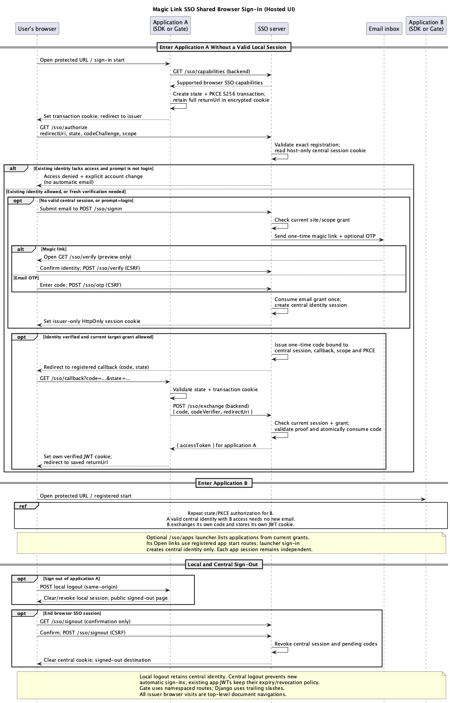
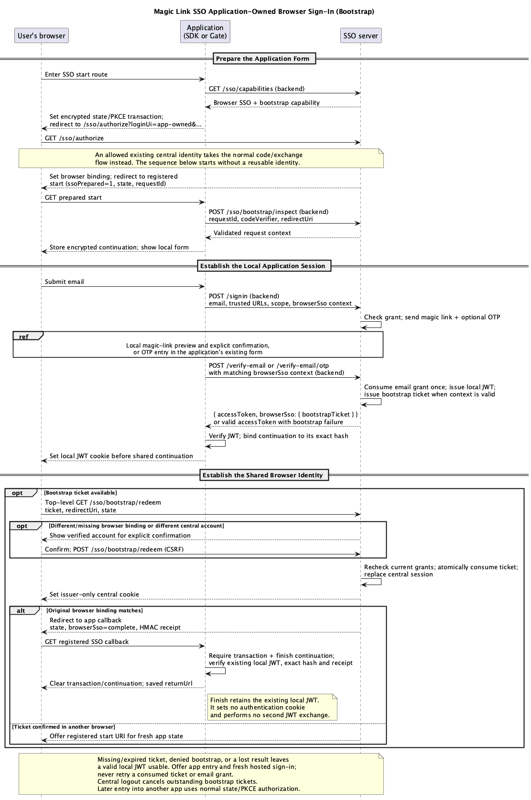

# Magic Link SSO authentication flows

Choose the flow that matches the application's configuration:

- [Email sign-in](#email-sign-in): browser SSO is off, the default.
- [Hosted browser SSO](#hosted-browser-sso): reuse a verified browser identity
  across allowed applications.
- [Application-owned browser SSO](#application-owned-browser-sso): keep the
  application's email/code form and establish shared identity after local
  sign-in.
- [Gate request flow](./gate.md#request-flow): protect a private upstream with
  either sign-in mode.

An application with a valid local session serves protected content using that
session. Shared browser sign-in participates when a new local session is needed.
Each application retains its own JWT, permissions and local sign-out.

## Email sign-in

This flow applies when browser SSO is off. Participants are the user, a client
application (Angular SSR, Fastify, Next.js, Nuxt or Django), the SSO server, the
email server, and the grant/token services. Gate uses the same email APIs behind
its [own namespaced routes](./gate.md#gate-namespace).

<picture>
  <source media="(prefers-color-scheme: dark)" srcset="./MagicLinkSSO_Flow_dark.png">
  <source media="(prefers-color-scheme: light)" srcset="./MagicLinkSSO_Flow_light.png">
  
</picture>

1. **Hosted redirect:** the client checks its auth cookie and redirects an
   unauthenticated user to `/signin`. The server resolves the site, checks its
   access rules and requested scope, and sends one email verification grant.
2. **Application form:** the client renders its own login UI; its backend posts
   `{ email, returnUrl, verifyUrl, scope? }` to the issuer's `/signin`. With OTP
   enabled, the JSON response includes public challenge metadata so the app can
   show a code field and exchange the code server-side.
3. **Link confirmation:** an app-owned callback previews the email token using
   `GET /verify-email?token=...` and the backend-only preview secret, shows the
   verified identity, and waits for explicit confirmation before
   `POST /verify-email`. The hosted callback uses a no-store confirmation page,
   a temporary HttpOnly token cookie and CSRF protection, removing the token
   from the URL before submission.
4. **OTP completion:** the already-open local or hosted page accepts the code
   through `POST /verify-email/otp`. The link and code consume the same one-time
   grant. The client verifies the resulting JWT's signature, issuer and
   audience, stores its auth cookie and returns to the requested page.

OTP is disabled by default and is an alternate way to spend the emailed grant,
not a second authentication factor. With the `rotate` resend policy, one active
challenge belongs to each normalized email/site/scope/return URL/verify URL
context. Resending invalidates that context's previous code; other contexts keep
their challenges. Browser SSO additionally binds email grants to individual
authorization requests so concurrent tabs remain independent.

These email APIs establish the local application session. Creating shared
browser identity from an application-owned form requires the
[bootstrap flow](#application-owned-browser-sso) below.

## Hosted browser SSO

Browser SSO is opt-in on the issuer and participating applications. The browser
visits the issuer as a top-level document; backend calls handle capability
discovery and code exchange. The central cookie stays on the issuer's dedicated
hostname. Applications keep their own cookies and JWTs.

<picture>
  <source media="(prefers-color-scheme: dark)" srcset="./MagicLinkSSO_Browser_SSO_Flow_dark.png">
  <source media="(prefers-color-scheme: light)" srcset="./MagicLinkSSO_Browser_SSO_Flow_light.png">
  
</picture>

The first hosted verification uses `/sso/signin`, `/sso/verify` and `/sso/otp`.
An allowed existing central identity skips email verification. Every application
starts its own state/PKCE transaction, and current site/scope grants are checked
at authorization and again at exchange. Application A's JWT grants no access to
B. An identity without target access receives a denial with an explicit account
change action.

The optional **My applications** launcher at `/sso/apps` lists entries from
current grants. Signing in there establishes central identity only; its Open
links enter registered application start routes and use the same flow above.

Local sign-out ends the current application's session and lands on a public
signed-out page. Central sign-out requires issuer confirmation and a
CSRF-protected POST. It prevents new automatic sign-ins; other applications'
existing JWTs retain their normal expiry/revocation policy. Account changes
require explicit email/OTP verification and preserve existing app identities
until their local sessions end.

The diagram uses SDK `/sso/start` and `/sso/callback` routes. SDK signed-out
pages default to `/sso/signed-out`; Django's default mount adds trailing
slashes. Gate uses `/_magicgate/sso/start`, `/_magicgate/sso/callback` and
`/_magicgate/signed-out`, including any configured public prefix and namespace.

In `auto` mode, legacy sign-in is selected before creating a transaction only
when discovery returns HTTP 404, explicitly disabled support or an unsupported
protocol version. `required` mode reports missing support. Timeouts, malformed
responses and server failures report an error. Code exchange is attempted once;
an unknown result requires a fresh transaction.

For configuration and recovery, see the
[deployment guide](./browser-sso-deployment.md). Wire formats, browser changes,
concurrent tabs and deadlines are defined in the
[browser session contract](./browser-sso-contract.md).

## Application-owned browser SSO

Enable the issuer's bootstrap extension and select `app-owned` login UI on the
application. An existing allowed central identity still takes the normal code
flow. Otherwise the application prepares its local form through the issuer and
establishes its own session before continuing shared setup.

<picture>
  <source media="(prefers-color-scheme: dark)" srcset="./MagicLinkSSO_Bootstrap_Flow_dark.png">
  <source media="(prefers-color-scheme: light)" srcset="./MagicLinkSSO_Bootstrap_Flow_light.png">
  
</picture>

The backend recovers the request and PKCE proof from encrypted HttpOnly cookies
and supplies the `browserSso` context with existing email APIs. After successful
local verification, it sets the application's JWT cookie. The browser then
navigates to the issuer to redeem a short-lived, one-use bootstrap ticket. A
JSON OTP handler can return a `continuationUrl` for full document navigation.

The original issuer binding permits redemption after the user's local
verification. A missing/different binding or a different active central account
requires explicit account confirmation. Another browser continues through a
registered start URI with fresh app state. An email opened without its original
application state can establish a local session after confirmation, but shared
setup remains incomplete.

The finish callback requires the original transaction, encrypted continuation,
existing local JWT with the expected hash, and issuer completion receipt. It
clears transient state and returns to the saved destination without setting an
authentication cookie or exchanging another JWT. A finish request without that
local JWT cannot establish authentication.

Missing or expired tickets, denied bootstrap and lost results preserve a valid
local session. Recovery offers app entry and an explicit fresh hosted sign-in;
it never retries a consumed ticket or email grant. Central sign-out cancels
outstanding bootstrap tickets. See the
[bootstrap setup guide](./browser-sso-deployment.md#enable-application-owned-forms)
and [extension contract](./browser-sso-bootstrap-contract.md).

## Diagram sources and regeneration

Sources: [overview](./MagicLinkSSO-Overview.puml),
[email sign-in](./MagicLinkSSO-Flow.puml),
[hosted browser SSO](./MagicLinkSSO-Browser-SSO-Flow.puml),
[application-owned bootstrap](./MagicLinkSSO-Bootstrap-Flow.puml), and
[Gate](./MagicLinkSSO-Gate-Flow.puml).

With PlantUML installed, run from the repository root:

```sh
pnpm docs:flow
```

This generates ten PNGs, a light and dark version of each diagram. Review both
themes and commit the images with their sources when publishing a documentation
change.
